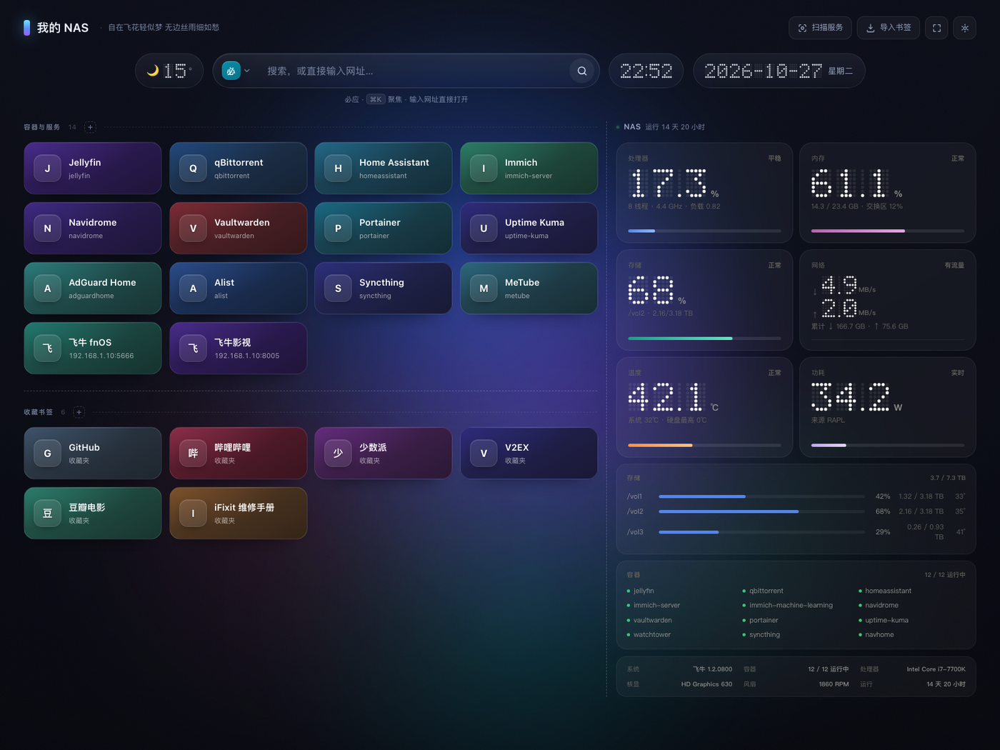

# fnStart · 飞牛开始页

> **一个只给飞牛 NAS 用户准备的浏览器主页。**
> 打开浏览器，你 NAS 上跑的东西全在这一屏：能点、能拖、能改，右边还挂着一块跟着飞牛监控实时跳动的仪表盘。



<p align="center"><sub>↑ 演示数据，不是任何人的真实内网</sub></p>

---

## 这玩意儿到底解决什么问题

用 NAS 的人大概都有这个流程：想开 Jellyfin，先在收藏夹里翻；想开 qBittorrent，忘了端口是 8080 还是 8081；想看看 CPU 现在多热，再切到飞牛监控那个页面。

fnStart 干的事很简单：**把这些散落的入口，收成一页。**

- 自动扫出 NAS 上所有带 Web 界面的服务（**包括那些用 host 网络、根本没做端口映射的容器**）
- 每张卡片自动配好图标、颜色、名字，扫完就能点
- 右侧融进一块飞牛监控面板，深色、点阵数字、底部细计量条，不弹窗、不套白框，直接长在背景上
- 顶部一条：左边天气、中间搜索（百度/必应/谷歌/…）、右边时间与日期
- 全屏一个按钮的事，浏览器标题栏菜单栏都不占地方

没有前端框架，没有 `npm install`，没有构建步骤。**零第三方依赖**，一个 `node server.js` 就跑起来了。

---

## 装它

**前提**：能 SSH 登录 NAS。飞牛里打开「设置 → 系统设置 → SSH」就行。

### 1 · 粘这一块

```bash
git clone https://github.com/IceNoproblem/fnstart.git /vol1/docker/fnstart
cd /vol1/docker/fnstart
sudo bash scripts/install.sh
```

看到 `✓ 装好了` 就成了。它会打印**访问地址**和**访问令牌**——令牌只显示这一次，抄进密码管理器。

<sub>第一行拉不动（国内常见）：把 `https://github.com/` 换成 `https://ghfast.top/https://github.com/`。</sub>
<sub>令牌会不会过期、忘了怎么找回、怎么换一把：[访问令牌的一生](#访问令牌的一生)。</sub>

### 2 · 打开

浏览器输入 `http://你的NAS地址:3721`，粘令牌，进去。

<sub>想设成浏览器首页：Chrome / Edge → 设置 → 启动时 → 打开特定网页。</sub>

### 3 · 想要右边那块监控面板？再跑一条

```bash
sudo bash /vol1/docker/fnstart/scripts/install-fnmonitor.sh
```

数据来自 **飞牛监控 fnMonitor**，第三方开源应用（作者 [MisiteQ](https://github.com/MisiteQ)，MIT 许可，[仓库](https://github.com/MisiteQ/fnmonitor)）。**不是飞牛自带的**，不在应用中心默认源里。不装也能用，只是右侧面板空着。

### 装不上？

| 卡在哪 | 怎么办 |
|---|---|
| 页面打不开 | `docker logs fnstart --tail 20`，看最后一行 |
| 卡在构建镜像 | NAS 拉不到 `node:22-alpine`，改用下面「其它装法 → docker run」 |
| 忘了令牌 | `grep ACCESS_TOKEN /vol1/docker/fnstart/.env` |
| 右侧读不到监控 | `curl http://你的NAS地址:8777/api/overview`；不通就是第 3 步没做 |
| 卡片没有容器名 | `docker logs fnstart-docker-proxy`，看它有没有起来 |
| 想整体体检 | `docker exec fnstart node /app/scripts/selftest.mjs` |

<details>
<summary><b>其它装法</b> — 手动 compose / docker run / 不用 Docker / 飞牛图形界面</summary>

**手动 compose**（不想用安装脚本）

```bash
cd /vol1/docker/fnstart
./scripts/new-token.sh --write
docker compose up -d --build
```

**docker run 两行流**（没有 compose 插件，或镜像拉不到时用这个）

先起 socket 代理（只有它挂 socket）：

```bash
docker run -d --name fnstart-docker-proxy --network host --restart unless-stopped \
  -v /vol1/docker/fnstart:/app:ro \
  -v /var/run/docker.sock:/var/run/docker.sock:ro \
  -w /app -e PROXY_LISTEN=127.0.0.1:2375 \
  node:22-alpine node docker-proxy.mjs
```

再起主应用（**不挂** socket）：

```bash
docker run -d --name fnstart --network host --restart unless-stopped \
  --cap-add=SYS_PTRACE \
  -v /vol1/docker/fnstart:/app -v /vol1/docker/fnstart/data:/data \
  -v /proc:/host/proc:ro \
  -w /app -e PORT=3721 -e DATA_DIR=/data \
  -e DOCKER_SOCK=http://127.0.0.1:2375 \
  -e ACCESS_TOKEN=你的令牌 \
  node:22-alpine node server.js
```

令牌用 `./scripts/new-token.sh` 生成；不写 `-e ACCESS_TOKEN` 就是无鉴权。

**不用 Docker**（有 Node 22 就行）

```bash
git clone https://github.com/IceNoproblem/fnstart.git && cd fnstart
PORT=3721 DATA_DIR=./data node server.js
```

**飞牛图形界面** — 把 `docker-compose.yml` 贴进「Docker → 项目 → 新建」，项目路径填 `/vol1/docker/fnstart`。该目录里要有源码，镜像是从源码构建的。

</details>

---

## 怎么用

**扫描服务** — 顶栏「扫描服务」，扫完后新发现的服务会作为卡片加进来。第一次打开页面时也会自动跑一次。

**导入书签** — 顶栏「导入书签」，把浏览器导出的 `bookmarks.html` 拖进去，收藏夹里的链接会归到下方「收藏书签」分组，跟服务卡片用一条虚线分开。

**编辑卡片** — 鼠标移上去，右上角出现两个小按钮（编辑 / 删除）。名字、地址、图标、颜色、备注都能改，也能上传自己的图。

**拖动排序** — 直接按住卡片拖，会实时让位、松手落位。分组之间也能拖。

**搜索时顺手找卡片** — 搜索框里打字，只要卡片名字/描述里对得上，卡片立刻亮起来（跟鼠标悬停一样的效果），下面还会告诉你命中几张。按回车就是真的去搜索了，高亮自动解除。

**右上角设置** — 站点标题、副标题、背景（极光 / 纯色 / 图片）、每行列数、天气城市、时钟时区，以及**任意一张卡片的单独开关**（不想让家人看到某些入口时很有用）。

**窄屏会自动变形** — 窗口不够宽时，监控面板收成右边一颗小胶囊，点它才铺开看详情；宽屏则并排显示。

**手机上也能用** — 不是把桌面版等比缩小，是重新排过：

- 搜索框独占一行，天气和时间落到第二行，左右分开（375px 宽也不挤）
- 卡片单列、更紧凑，一屏能多看两张
- 手机上**没有悬停**，所以卡片的编辑/删除按钮直接常显，不用先"hover 一下"再去点
- 手机上**不能拖拽排序**（手指一滑页面就得滚，两者必然打架），改成**长按卡片**弹操作面板：上移一位 / 下移一位 / 编辑 / 删除
- 输入框字号锁在 16px，避免 iOS 一点就自动放大页面
- 底部悬浮按钮滚动时自动淡出，不挡卡片；适配 iPhone 的底部安全区
- 日期条在 920px 以下自动收起（一行塞不下四样东西）

---

## 它凭什么能自动发现我的服务

这是这个项目里唯一有点技术含量的部分，值得单独说：

1. **读宿主机的 `/proc/net/tcp`**，拿到所有处于 LISTEN 的端口。所以 `--network host` 的容器（没有端口映射）也能被发现——这是关键，NAS 上大部分容器都是 host 网络。
2. 对每个端口做一次 TCP 探活，再发一个轻量 HTTP 请求，从 `<title>` 里猜出这是哪个服务。404 页、报错页会被过滤掉，不会给你生成一张"Error"卡片。
3. **认领容器名**：bridge 网络的容器从 Docker API 的端口映射直接读；host 网络的容器没有映射，就反过来查——端口 → socket inode → 持有它的进程 → 属于哪个容器。这一步需要容器能看见宿主机进程表，也就是 compose 里那两个配置：

```yaml
cap_add: [SYS_PTRACE]              # 读 /proc/<pid>/fd 需要
volumes:
  - /proc:/host/proc:ro            # 看见宿主机的进程
```

`SYS_PTRACE` 听起来吓人，它只用于"读进程打开了哪些 socket"，本项目没有任何写操作、不 attach、不注入。**不想给也完全没问题**：去掉它，host 网络的容器会退回用网页标题命名（卡片叫"qBittorrent WebUI"而不是容器名），功能不受影响。

4. 图标是运行时去各服务页面抓 `favicon`，抓到就存到 `data/icons/`，抓不到就用名字首字母配一个颜色——所以离线也能看。

---

## 配置项

全是环境变量，改 `docker-compose.yml` 即可。

| 变量 | 默认 | 说明 |
|---|---|---|
| `PORT` | `3721` | 监听端口 |
| `DATA_DIR` | `/data` | 数据目录（卡片、图标、背景、快照） |
| `MONITOR_URL` | 空 | 飞牛监控地址。**留空 = 自动用「访问本页的主机名:8777」**，换 IP 不用改 |
| `MONITOR_PORT` | `8777` | 上面那个自动地址用的端口 |
| `WEATHER_CITY` | `北京` | 天气默认城市，页面上也能改 |
| `PUBLIC_HOST` | 空 | 强制卡片地址用这个主机名（反向代理/域名场景） |
| `DOCKER_SOCK` | `http://127.0.0.1:2375` | 走 socket 代理。改成 `/var/run/docker.sock` 就是直连（不建议，见上文） |
| `PROC_ROOT` | 自动 | 宿主机 procfs 挂载点，默认探测 `/host/proc` |
| `PROBE_TIMEOUT` | `2500` | 单个端口探测超时（毫秒），服务多可调到 3000 |
| `PROBE_CONCURRENCY` | `8` | 探测并发 |
| `PROBE_PORTS` | 空 | 额外扫描的端口，逗号分隔（拿不到 `/proc` 时的兜底） |
| `ACCESS_TOKEN` | 空 | **访问令牌**。留空 = 不校验（纯内网用）；一旦打算暴露到公网就必须设。用 `./scripts/new-token.sh --write` 生成，写在 `.env` 里，别写进 compose。详见[访问令牌的一生](#访问令牌的一生) |
| `BLOCK_PRIVATE_FETCH` | 跟随令牌 | 禁止服务端去抓内网地址的图标（防 SSRF）。设了 `ACCESS_TOKEN` 会自动开启，纯内网想关掉就显式设 `0` |

数据存在 `DATA_DIR` 里：`data.json`（卡片与设置）、`icons/`、`backgrounds/`、`last-monitor.json` / `last-weather.json`（网络抖一下时的兜底快照）。**备份整个目录就等于备份了整个站**，或者访问 `/api/export` 导出一份 JSON。

---

## 接口

给想接自动化的人（也方便你自己写脚本改卡片）：

| 方法 | 路径 | 作用 |
|---|---|---|
| GET | `/api/state` | 全部设置 + 卡片 |
| PATCH | `/api/settings` | 改设置（深合并） |
| POST | `/api/cards` | 新建卡片 |
| PATCH / DELETE | `/api/cards/:id` | 改 / 删卡片（`hidden` 控制显隐） |
| POST | `/api/cards/reorder` | 拖动排序 |
| GET / POST | `/api/discover` | 扫描服务（`?apply=0` 只扫描不落库） |
| POST | `/api/import` | 导入浏览器书签 |
| POST | `/api/icon/fetch` | 给一个网址抓图标 |
| POST | `/api/upload/icon` · `/api/upload/background` | 上传图片（base64 data URI） |
| GET | `/api/monitor/stats` | 监控快照（飞牛监控不可用时回退上次缓存） |
| GET | `/api/monitor/ping` | 探一下监控地址通不通 |
| GET | `/api/weather` | 天气 |
| GET | `/api/export` | 导出整份数据 |
| GET | `/fn/*` | 反向代理到飞牛监控（含 WebSocket） |

---

## 暴露到公网之前

默认状态下 fnStart **不适合直接映射到公网**。我用一个临时实例实测过几条真实可用的攻击路径，不是理论推演：

| 问题 | 实测结果 |
|---|---|
| 零鉴权 | `GET /api/state` 直接吐出全部卡片与书签地址（等于一份内网拓扑图）；`/api/export` 直接下载整份备份 |
| **可变成开放代理** | 匿名 `PATCH /api/settings` 改掉监控地址后，`GET /fn/` 会替你访问内网任意 HTTP 服务并返回内容 —— 实测取回了 qBittorrent 的完整页面 |
| 上传可存 XSS | 上传含 `<script>` 的 SVG，访问时以 `image/svg+xml` 返回，浏览器会执行（同源） |
| 图标抓取可被利用 | `/api/icon/fetch` 会让服务器替你请求任意地址，可用来盲探内网端口 |

### 设了令牌之后实测还挡不挡得住

自带一份攻击面自测，跑一次就知道当前版本的实际水平：

```bash
BASE=http://127.0.0.1:3721 ACCESS_TOKEN=你的令牌 node scripts/attack-test.mjs
```

1.3.2 在 NAS 实机的成绩（14 项全过）：

| 打什么 | 结果 |
|---|---|
| 鉴权绕过 12 种变形（`//api`、`/API`、`/%61pi`、伪造 cookie、空 token…） | 全部 401，无数据泄漏 |
| 登录爆破 | 400ms → 800ms → 1.6s → 3.2s 递增；正确令牌仍立刻放行 |
| 目录穿越 6 种编码 | 全挡 |
| 改设置把 `/fn/` 变成内网跳板 | 失效（代理目标锁定启动配置） |
| 恶意 SVG（`<script>` + `onload`） | 内容被清洗，且响应带 `CSP: default-src 'none'` |
| 3MB 上传 | 413 |
| 安全响应头 | `nosniff` / `SAMEORIGIN` / `no-store` / `no-referrer` 齐全 |

### Docker socket 已经收进只读代理

要把端口归属反查到容器名，就得读 Docker API。但直接挂 `/var/run/docker.sock` 有个坑：**`:ro` 不等于只读**——实测容器内仍能 `POST /containers/create`。也就是说，主进程一旦被攻破，攻击者就拿得到宿主机 root。

所以默认改成两个容器：

```
fnstart               ← 主应用，完全不挂 socket
fnstart-docker-proxy  ← 只有它挂 socket，只放行三个 GET，其余一律 403
                        （绑定 127.0.0.1:2375，局域网和公网都碰不到）
```

放行的只有 `/version`、`/containers/json`、`/containers/<id>/json` —— 正好是 fnStart 需要的全部。实测拒绝情况：

```
POST /containers/create   → 405   只允许 GET
GET  /secrets             → 403
GET  /images/json         → 403
GET  /containers/x/export → 403   导出容器文件系统，堵掉
```

于是「被攻破」的后果从**宿主机 root** 降到**只能读容器列表**。

想退回旧行为（少一个容器、省 10MB 内存），把 compose 里的 `DOCKER_SOCK` 改回 `/var/run/docker.sock`，并把那行 socket 挂载加回主服务。**不建议。**

### 还剩一条：容器以 root 运行

这同样是架构性的：读宿主 `/proc/<pid>/fd`（把端口反查到进程）需要权限，非 root 会让这个功能退化。只在「已经被拿下」之后才有意义，但写在明处。

### 设一个令牌（最低要求）

```bash
# 在项目目录里，一条命令生成并写进 .env
./scripts/new-token.sh --write
```

它会打印新令牌、写进 `.env`（权限 600，已在 `.gitignore` 里，不会进仓库），然后：

```bash
docker compose up -d
```

不想用脚本就自己生成，效果一样：

```bash
openssl rand -hex 16        # 32 个十六进制字符
echo "ACCESS_TOKEN=粘到这里" >> .env
```

设了之后：

- 浏览器访问会看到一张登录页，输入令牌即可（写入 httpOnly cookie，30 天有效，存的是令牌的 sha256 而不是令牌本身）
- 脚本用 `Authorization: Bearer <token>`，或者一次性链接 `?token=xxx`（验证后自动转 cookie 并抹掉地址栏里的参数）
- **顺手关掉两个洞**：`/fn/` 代理只认启动时的 `MONITOR_URL`/`MONITOR_PORT`，设置里改监控地址不再影响服务端请求（开放代理失效）；`/api/icon/fetch` 禁止抓内网与环回地址
- 上传限制到单张 2MB、目录总量 200MB；SVG 会做内容清洗，并在响应头加 `Content-Security-Policy: default-src 'none'`（脚本、事件属性全部失效）
- 代理转发时会**摘掉自己的令牌和 cookie**，只保留上游自己的那些 —— 否则你的访问令牌会跟着请求落进 fnMonitor 的日志里
- 登录连续失败会逐步变慢（400ms → 5s），脚本爆破没有意义

不设令牌时以上保护不启用（`BLOCK_PRIVATE_FETCH` 除外可单独设），行为和以前完全一样 —— 内网照常用，不会因为这次加固少任何功能。

---

### 前面再套一层 HTTPS + 密码

令牌走明文 HTTP 等于没设，务必套一层带 TLS 的反向代理。Caddy 两条就够：

```
start.example.com {
  basic_auth {
    you <用 caddy hash-password 生成的 bcrypt 串>
  }
  reverse_proxy 127.0.0.1:3721
}
```

Nginx 版本：

```nginx
location / {
  auth_basic "fnStart";
  auth_basic_user_file /etc/nginx/.htpasswd;
  proxy_pass http://127.0.0.1:3721;
  proxy_set_header Host $host;
  proxy_set_header X-Real-IP $remote_addr;
  # 监控面板内嵌模式要转发 WebSocket
  proxy_http_version 1.1;
  proxy_set_header Upgrade $http_upgrade;
  proxy_set_header Connection "upgrade";
  proxy_read_timeout 300s;
}
```

### 仍然建议：优先用组网，不要暴露端口

Tailscale / WireGuard 组网之后，出门也能直接开 `http://100.x.x.x:3721`，端口根本不出公网：上面所有问题一次性消失，还自带加密与身份认证。代价只是每台设备装个客户端。

### 还有两件和安全无关、但会先绊住你的事

- 家宽的 80/443 常被运营商封，高位端口（如 3721）一般能通；公网 IP 会变，需要 DDNS
- 个人宽带对外提供服务，各地对备案的要求不一样，自己留意

---

## 常见问题

**为什么不把 fnMonitor 一起写进 docker-compose，一条命令全起来？**

问得好，我先试过这条路，但放弃了。原因不是懒，是它压根不是"容器型"应用——fnMonitor 是个**宿主机监控代理**，它的工作就是去摸硬件：

- 调外部命令：`smartctl`（硬盘 SMART）、`storcli`/`perccli`（RAID 阵列卡）、`sensors`（温度风扇）、`ipmitool`（BMC）、`hdparm`、`lscpu`、`dmidecode`、`nvidia-smi`
- 读系统路径：`/sys/class/hwmon`（传感器）、`/sys/block`、`/proc/{cpuinfo,stat,meminfo,mounts}`、`/dev/sd*`
- 还有更狠的：`/dev/port` —— 直接读 I/O 端口，用来兼容 NEC / 联想商用机那种走私有 EC 邮箱的风扇

要把它塞进容器，就得 `privileged: true`、挂 `/sys` `/dev` `/proc` `/var/apps` `/vol1/@appcenter` `/usr/trim`，再在镜像里装齐上面那堆系统工具。**这等于把整台 NAS 交给一个容器**，比装个 FPK 危险得多；顺带还会丢掉桌面图标和飞牛应用中心的升级管理，并且要跟着上游一天几版的迭代不停改我们的 compose。

所以这一版的分工是：**fnMonitor 用它的方式装（一条命令），fnStart 用容器跑，两边只通过 `:8777/api/overview` 这个 HTTP 接口说话。** 谁升级都不影响谁。

**右侧面板一直是"读不到监控数据"？**
第 3 步没做，或者 8777 不通。`curl http://你的NAS:8777/api/overview` 试一下。用反代/HTTPS 的话，把 `MONITOR_URL` 显式写死。

**只扫出来一半服务？**
大概率是 host 网络容器没认领到名字，不是没发现。看看扫描结果里的端口数对不对；想认领名字就加上 `SYS_PTRACE` 和 `/proc` 挂载。另外 `PROBE_TIMEOUT` 太小会把慢服务漏掉，调到 3000 试试。

**卡片地址变成了 `127.0.0.1`？**
说明你是从 NAS 本机用 `127.0.0.1` 打开的。程序会自动换成局域网 IP，但如果机器有多个网卡可能挑错，这种时候设 `PUBLIC_HOST=192.168.x.x`。

**天气显示 `--`？**
天气走 open-meteo，需要外网。墙内偶尔抽风，失败时会退回上次成功的快照（6 小时内有效），所以一般只会短暂显示旧数据。

**能不能放到公网？**
默认**不行**——不设 `ACCESS_TOKEN` 时它没有任何鉴权，任何能访问到端口的人都能改卡片、读监控、导出整份备份。一定要外网访问，请先读完下面那节【暴露到公网之前】。

**令牌会自己变吗？30 天后要重新生成吗？**
都不会。令牌是你自己设的死值，程序不会自动生成、也不会自动更换 —— 到期的是**登录 cookie**（30 天），不是令牌。第 31 天看到登录页，把同一串令牌再贴一次就行。而且 cookie 是滑动续期，只要期间打开过主页就一直顺延，正常使用基本碰不到它。完整流程见[访问令牌的一生](#访问令牌的一生)。

**忘了令牌怎么办？**
`grep ACCESS_TOKEN .env`；`.env` 也没了就读容器环境变量：`docker inspect fnstart --format '{{range .Config.Env}}{{println .}}{{end}}' | grep ACCESS_TOKEN`。都找不到就换一把新的，卡片数据不受影响。

**改了代码为什么没生效？**
`docker restart` 只重启进程，不换代码——`/app` 里的文件是构建进镜像的，不是挂载的。改完源码必须 `docker compose up -d --build`。判断依据：`docker exec fnstart grep 新函数名 /app/lib/xxx.js`，搜不到就是没重建。

**改了设置为什么不生效？**
`data/data.json` 里存着呢，重启容器当然还在。如果改的是 `data.json` 文件本身，需要重启容器（进程内有一份缓存）。

**会往外发我的数据吗？**
不会。唯一的对外请求是天气（open-meteo，只发城市名和坐标）。没有统计、没有遥测、没有回连。

---

## 访问令牌的一生

这一段是给「从仓库克隆、自己部署」的人看的。四件事说清楚：令牌从哪来、怎么用、什么时候续、忘了怎么办。

先纠正最容易混的一对概念 —— 这两个东西经常被当成一个：

| | 访问令牌 | 登录 cookie |
|---|---|---|
| 是什么 | 你在 `.env` 里设的那串字符 | 登录成功后浏览器保存的凭证 |
| 谁生成 | **你**，手动生成，之后一直不变 | 服务端签发，值 = 令牌的 sha256 |
| 会过期吗 | **不会**。除非你去改 `.env`，否则永远有效 | **30 天不活动就失效** |
| 存在哪 | `.env`、你的密码管理器 | 浏览器 cookie，`fnstart_auth` |
| 能干嘛 | 等于管理员权限：改卡片、导备份、看监控 | 同上（它是令牌的等价凭证） |

所以：**令牌不会自动生成，也不会自动更新；到期的是 cookie。** 第 31 天你看到的登录页，只需要把同一串令牌再贴一次，不用重新生成。

### 第 1 步：生成

```bash
./scripts/new-token.sh --write      # 生成 32 位十六进制，写进 .env
./scripts/new-token.sh --write 32   # 想要 64 位就传 32（单位是字节）
```

生成完立刻抄进密码管理器（1Password / Bitwarden / macOS 钥匙串都行）。**这一步别偷懒** —— 令牌只存在于两个地方：`.env` 和你的记忆。丢了就得换一把。

为什么不「首次启动自动生成」？因为隐式生成的密码最容易丢：它躺在某段日志或某个容器环境变量里，谁也没记住，换机器就找不回来。显式生成、当场抄走，反而最稳。

### 第 2 步：首次登录

浏览器打开 `http://你的地址:3721`，贴令牌，进入。之后 cookie 记 30 天。

手机上不想手打那一长串，就用一次性链接：

```
http://你的地址:3721/?token=那串令牌
```

打开后服务端会立刻换发 cookie 并 303 跳回干净地址，地址栏里的令牌随即消失。**但链接本身还是带着令牌** —— 它会留在浏览器历史、聊天记录、反代访问日志里。所以只在自己的设备之间传，别发到群里。

### 第 3 步：续期（不用你管）

cookie 是**滑动续期**：每次打开主页就把 30 天重新算起。你天天用就永远不会掉；出差两周回来打开，还在；真正闲置超过 30 天才需要重登一次 —— 而重登也只是把同一串令牌再贴一次。

服务端只在「打开页面」时重发 cookie，静态资源和接口不重发，所以不会每个图标都背一个 `Set-Cookie`。

### 第 4 步：换令牌 / 把某台设备踢下线

没有「单独吊销某台设备」的功能。要踢人（比如手机丢了），就**换一把令牌**：

```bash
./scripts/new-token.sh --write   # 生成新的，覆盖 .env
docker compose up -d             # 重建容器，让新令牌生效
```

容器重建后 `AUTH_HASH` 变了，**所有已登录设备的 cookie 立刻全部失效**，包括你自己的。这是目前唯一的吊销手段，也是它足够简单的原因：一个令牌、一个开关。

注意 `docker restart` 不够 —— 环境变量不会重读，必须 `up -d` 重建容器。

### 忘了令牌怎么办

令牌没有后门、没有找回邮件，但它就写在你的 `.env` 里：

```bash
grep ACCESS_TOKEN .env
```

`.env` 也丢了的话，从运行中的容器里读（这是令牌唯一还会留下的地方）：

```bash
docker inspect fnstart --format '{{range .Config.Env}}{{println .}}{{end}}' | grep ACCESS_TOKEN
```

两处都找不到，就只能换一把新的（回到第 4 步）。数据不会丢 —— 卡片在 `data/` 里，跟令牌无关。

顺带一提：启动日志只会报「已开启（令牌 N 位）」，**永远不会打印令牌本身**。因为 `docker logs` 是很多人会随手贴到群里求助的东西。

### 如果不止你一个人用

那不建议把令牌发给对方 —— 它是管理员权限，对方能删你的卡片、导出你的备份。正确做法是把认证放在反向代理层（Caddy `basic_auth`、Nginx `auth_basic`、或者雷池 WAF 的「身份认证」），每个人的账号密码由那一层管，fnStart 的令牌只属于你自己。这样谁进来看得见、谁能进，也都有日志。

---

## 用了谁的东西

这个项目站在别人肩膀上，该说清楚的都写在这儿。

**飞牛监控 fnMonitor** — 本项目的右侧面板，数据、观感、点阵数字的审美都来自它。
作者 **Misite齊**（GitHub [@MisiteQ](https://github.com/MisiteQ)），**MIT 许可**，仓库：<https://github.com/MisiteQ/fnmonitor>。它是个纯 Python 标准库 + 单文件前端的应用，零第三方依赖、数据只留在本机 SQLite，确实下了功夫，推荐去给它点个 star。
需要说明的是：**本仓库不包含 fnMonitor 的任何代码或样式表**，我们只是消费者——通过 HTTP 读它的 `/api/overview`。早期原型为了对照效果曾经直接引用过它的 CSS，开源前已经整份删除并重写为 `public/css/fn-theme.css`（约 4KB，全是本项目自己写的规则），点阵字模也是自己写的 5×7 位图表。本项目与 fnMonitor 作者、与飞牛官方**都没有隶属或背书关系**。

**飞牛 fnOS** — 运行平台。fnStart 依赖它提供的东西：`/proc/net/tcp`、Docker、以及应用中心装出来的 fnMonitor。本项目与飞牛官方无隶属关系。

**open-meteo** — 天气数据来源，免费、免密钥。数据以 [CC BY 4.0](https://creativecommons.org/licenses/by/4.0/) 授权提供，感谢他们不收费也不要求注册。
<https://open-meteo.com/>

**Node.js** — 运行时，MIT License。

**图标** — 界面上的所有 SVG 图标（搜索、编辑、扫描、全屏…）都是本项目手写的 path；卡片图标是运行时从你各个服务自己的页面上抓的 favicon，版权归各服务方。

**没有用到的**：React / Vue / Tailwind / 任何 npm 包。`package.json` 里 `dependencies` 是空的，你 `npm install` 会得到"up to date"然后无事发生。

---

## 许可

[MIT](LICENSE) © 2026 IceNoproblem

随便用、随便改、随便商用，出事了别找我（MIT 的原话比这长一点，意思一样）。

---

## 最后

这是一个自己用着顺手、顺手做完整的小工具。如果你也是飞牛用户，希望它能让你每天少点几下鼠标。

有问题、有想法、发现它在你机器上认不出某些服务，欢迎开 issue 把端口和现象贴上来。
